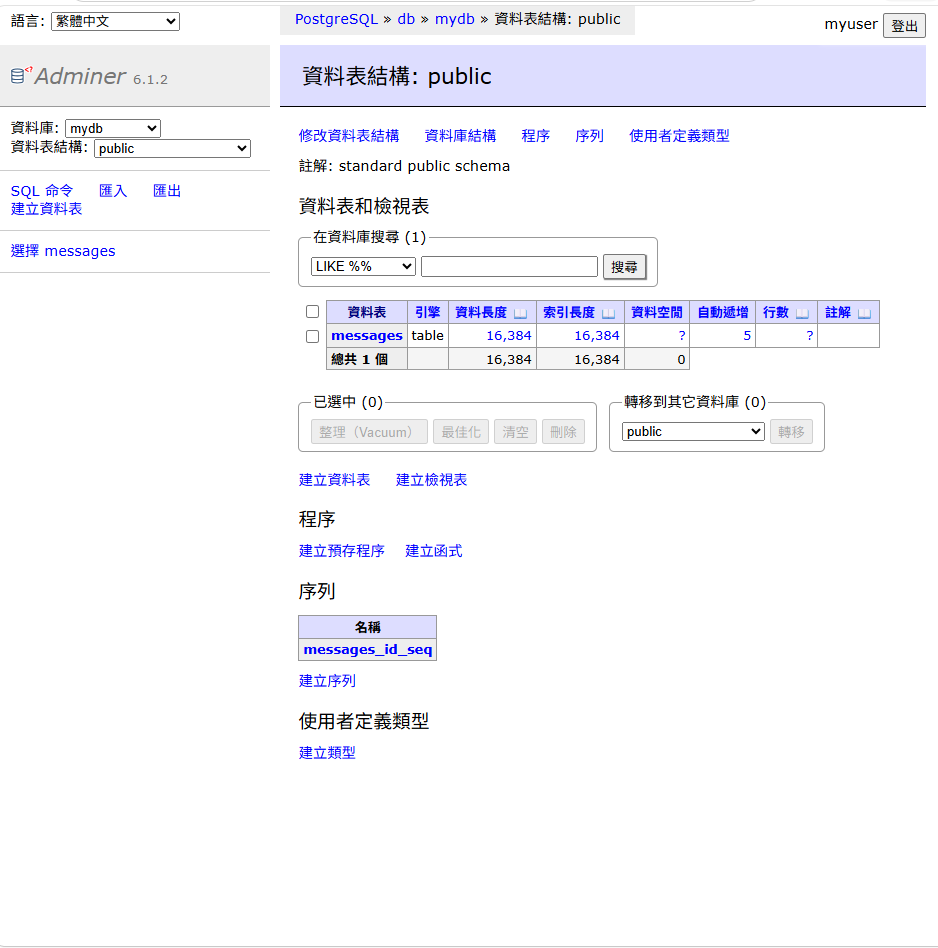
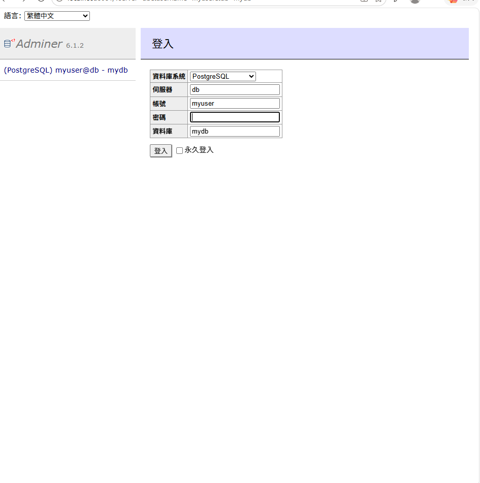
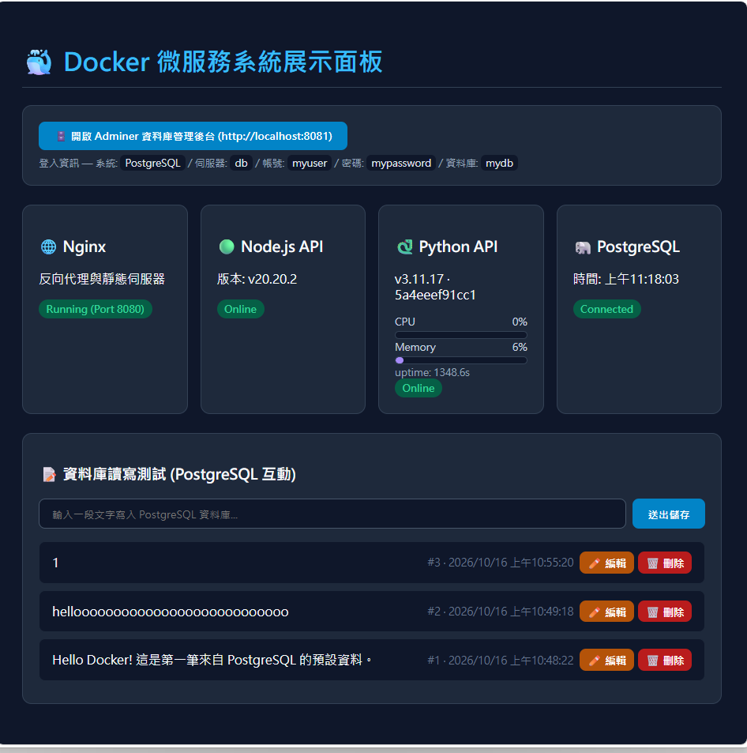

# Docker 學習紀錄與微服務系統建置（HW5）

本專案為 Docker 學習筆記與微服務架構實作作業。系統採用 **Docker Compose** 進行多容器編排，整合 **Nginx**（網頁伺服器與反向代理）、**Node.js**（留言 CRUD API）、**Python FastAPI**（系統監控 API）、**PostgreSQL**（關聯式資料庫）與 **Adminer**（資料庫管理後台），並提供互動式 Web 介面展示系統運行狀態。

---

## 一、 Docker 核心概念與學習紀錄

### 1. 為什麼需要 Docker？
在傳統開發中，常因為作業系統或套件版本差異導致「在我電腦上可以跑，部署卻失敗」的問題。Docker 透過容器化（Containerization）技術，將應用程式與執行環境打包在一起，達到環境隔離與跨平台一致性的效果。

### 2. 三大核心元件
* **Image（映像檔）**：唯讀的環境模板（如 `nginx:alpine`、`postgres:15`），用來建立容器。
* **Container（容器）**：映像檔的執行實例，彼此隔離且輕量。
* **Volume（資料卷）**：用於持久化保存容器內的資料（例如資料庫檔案），避免容器刪除後資料遺失。

### 3. 常用指令整理
```bash
# 查看目前執行中的容器
docker ps

# 依據 docker-compose.yml 建置並啟動所有服務（背景執行）
docker compose up -d --build

# 查看服務運行日誌
docker compose logs -f

# 只重建 nginx（修改 nginx.conf / index.html 後）
docker compose up -d --force-recreate nginx

# 停止並移除所有容器與網路
docker compose down
```

---

## 二、 微服務系統架構設計（5 容器）

本系統包含五個 Docker 容器，並透過自訂的 Bridge Network (`app-network`) 進行內部通訊：

```text
[ 使用者瀏覽器 ]
       │ HTTP :8080 ── Web UI (index.html)
       ▼
┌─────────────────────────────┐
│  nginx (Web & Reverse Proxy)│ ── 靜態頁面 (`/` -> index.html)
└─────────────────────────────┘
       │ 反向代理
       ├─ `/api/python/*` -> http://python:8000 (FastAPI)
       └─ `/api/*`        -> http://backend:3000 (Node.js)
              │
              ├─ backend (Node.js 20 + Express) ── 留言 CRUD，連 PostgreSQL
              ├─ python  (Python 3.11 + FastAPI) ── CPU / Memory / Hostname 監控
              └─ db (PostgreSQL 15) ── 儲存 messages，掛載 pgdata 持久化
                      ▲
                      └─ adminer (DB 管理後台, :8081) ── 瀏覽 messages 資料表
```

| 容器 | 映像 / 建置 | 端口 | 說明 |
| --- | --- | --- | --- |
| `nginx_proxy` | `nginx:alpine` | `8080:80` | 靜態前端 + 反向代理 |
| `node_backend` | `./backend` (node:20-alpine) | 內部 `3000` | 留言 CRUD API |
| `python_api` | `./python` (python:3.11-slim) | 內部 `8000` | 系統監控 API |
| `postgres_db` | `postgres:15-alpine` | 內部 `5432` | 資料庫 (`pgdata` 持久化) |
| `db_adminer` | `adminer` | `8081:8080` | 資料庫網頁後台 |

---

## 三、 專案目錄結構

```text
.
├── README.md               # 學習紀錄與系統說明文件
├── .gitignore              # 忽略 node_modules / __pycache__ / .DS_Store 等
├── docker-compose.yml      # 5 容器編排設定檔
├── nginx/
│   ├── nginx.conf          # Nginx 反向代理與靜態路由設定
│   └── index.html          # 前端展示介面 (Web UI，4 卡片 + CRUD + 即時監控)
├── backend/
│   ├── Dockerfile          # Node.js 微服務建置腳本
│   ├── .dockerignore       # 建置忽略檔
│   ├── package.json        # express + pg 相依套件
│   └── server.js           # Express 後端 API 與 PostgreSQL 連線邏輯
├── python/
│   ├── Dockerfile          # FastAPI 微服務建置腳本
│   ├── .dockerignore       # 建置忽略檔
│   ├── requirements.txt    # fastapi + uvicorn + psutil
│   └── main.py             # 系統監控 API
└── 圖片/                   # 運行截圖
```

---

## 四、 API 列表

### Node.js 留言 CRUD（經 Nginx：`http://localhost:8080/api/...`）

| 方法 | 路徑 | 說明 |
| --- | --- | --- |
| GET | `/api/status` | 健康檢查：Node 版本 + DB 時間 |
| GET | `/api/messages` | 取得最新 20 筆留言 |
| POST | `/api/messages` | 新增留言 `{ "content": "..." }` |
| PUT | `/api/messages/:id` | 修改留言 `{ "content": "..." }` |
| DELETE | `/api/messages/:id` | 刪除留言 |

### Python 系統監控（經 Nginx）

| 方法 | 路徑 | 說明 |
| --- | --- | --- |
| GET | `/api/python/health` | `{"status":"ok"}` |
| GET | `/api/python/status` | Python 版本、hostname、CPU%、Memory%、uptime |

---

## 五、 如何啟動與展示系統

### 1. 啟動系統
```bash
docker compose up -d --build
```

### 2. 瀏覽 Web 展示介面
👉 **http://localhost:8080**

- 4 張狀態卡：Nginx / Node.js / **Python API（含 CPU、Memory 進度條，每 3 秒自動更新）** / PostgreSQL
- 留言板：新增、**✏️ 編輯**、🗑️ 刪除，資料即時寫入 PostgreSQL
- 頂部有 **🗄️ 開啟 Adminer** 按鈕

### 3. Adminer 資料庫後台
👉 **http://localhost:8081**

| 欄位 | 值 |
| --- | --- |
| 系統 | `PostgreSQL` |
| 伺服器 | `db` |
| 使用者名稱 | `myuser` |
| 密碼 | `mypassword` |
| 資料庫 | `mydb` |

登入後可瀏覽 `messages` 資料表（`id / content / created_at`）。

---

## 六、 測試指令

```bash
# 健康檢查
curl http://localhost:8080/api/status
curl http://localhost:8080/api/python/status

# 完整 CRUD（PowerShell 建議用 python 避免引號問題）
python -c "import urllib.request,json; data=json.dumps({'content':'hello'}).encode(); req=urllib.request.Request('http://localhost:8080/api/messages',data=data,headers={'Content-Type':'application/json'}); print(urllib.request.urlopen(req).read().decode())"
curl http://localhost:8080/api/messages

# 修改第 1 筆（PUT）、刪除第 5 筆（DELETE）
curl -X PUT -H "Content-Type: application/json" -d "{\"content\":\"edited\"}" http://localhost:8080/api/messages/1
curl -X DELETE http://localhost:8080/api/messages/5

# 看日誌
docker compose ps
docker compose logs backend --tail 20
docker compose logs python --tail 20
docker compose logs nginx --tail 20
```

---

## 七、 系統實際運行成果展示

> 截圖放在 `圖片/` 資料夾（新版三張）。





<!-- 如需新增截圖：
1. 把圖片存進 `圖片/`（例如 `screenshot-adminer.png`）
2. 在下方加一行 ``
-->
